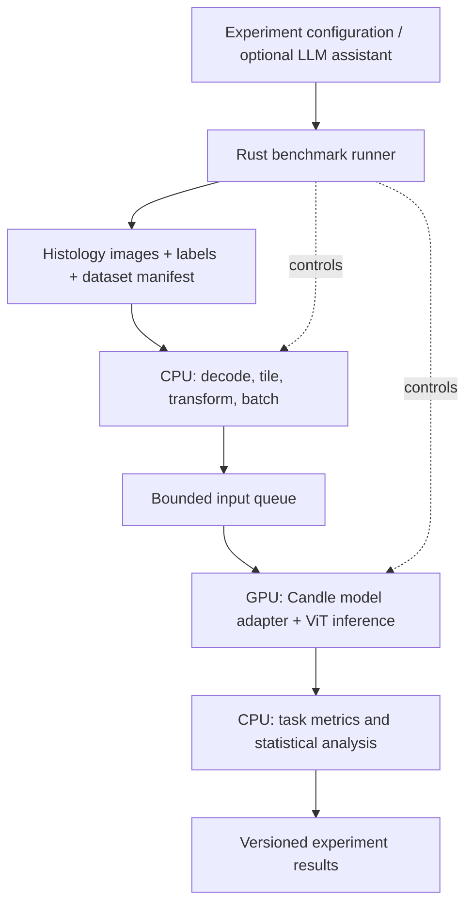

# ViT Research Engine — Pattern Recognition and Performance Optimization

**Experimental research infrastructure for Vision Transformers (ViTs), built with Rust, Hugging Face Candle, and NVIDIA CUDA.**

This project investigates two related questions:

1. **Visual recognition:** how reliably do different vision models identify patterns in histopathological imagery, initially focusing on oral squamous cell carcinoma (OSCC)?
2. **Computational efficiency:** which changes to inference algorithms, numerical operations, data movement, or CPU/GPU scheduling improve execution time and memory use without unacceptable loss of recognition quality?

The long-term goal is a **model-agnostic, reproducible benchmark environment**, not an application tied to a single pretrained model. **DINOv2 Base (`facebook/dinov2-base`) is the initial reference model, not a permanent dependency.**

> **Project status — research prototype (October 2026).** The repository currently contains an early image-to-tensor experiment and a Docker/CUDA development environment. Full DINOv2 inference, model adapters, automated benchmarks, Ollama/llama.cpp integration, and the proposed workload scheduling architecture are **planned, not implemented**. The current Rust entry point needs fixes before it compiles. This README documents both the present state and the intended direction.
>
> **Research use only.** This code is not a validated medical diagnostic system. Clinical claims would require separately designed validation, representative datasets, and appropriate expert review.

## Research objectives

### 1. Recognition quality

Evaluate whether a vision model can recognize task-specific visual patterns in oral histopathology images. Exact evaluation metrics depend on the labels available:

- **Classification:** balanced accuracy, precision, recall, sensitivity, specificity, macro-F1, AUROC and confusion matrices.
- **Localization/detection:** intersection over union (IoU), average precision and mAP when region-level annotations are available.
- **Segmentation:** Dice score and IoU when pixel-level masks are available.
- **Feature/embedding comparison:** retrieval metrics and explicitly defined similarity benchmarks when no task-specific classifier is used.

**A pretrained DINOv2 encoder alone does not establish OSCC classification or localization performance.** Depending on the task, it may require a trained classification head, a separate detection/segmentation component, or a validated feature-based evaluation protocol.

### 2. Robustness and generalization

Run the same held-out images through controlled transformations and measure the change in performance:

- Translation and **patch-boundary sensitivity**, including sub-patch shifts.
- Rotation, scaling and changes in input resolution.
- Noise, blur, compression and illumination changes.
- Histology stain/color variability and background interference.
- Partial occlusion, when the original label remains valid.
- Out-of-distribution data, with clearly defined source/site shifts.

Transformations that alter the ground-truth class must not be treated as label-preserving tests.

### 3. Computational optimization

Study the computational cost of inference, particularly:

- Attention and matrix multiplication, tensor layouts and allocations.
- CPU image decoding and preprocessing; GPU batch execution.
- Host-to-device transfer overhead, data-loader contention and synchronization.
- Batch size, input resolution, mixed precision (where supported), throughput and peak VRAM.
- Comparison of mathematical/kernel optimizations **within the same model** separately from **comparisons between different models**.

An optimization is only considered beneficial after checking its impact on both numerical correctness and relevant task metrics.

## Research environment

| Component                  | Reference environment                                                                                                   |
| -------------------------- | ----------------------------------------------------------------------------------------------------------------------- |
| Main language              | Rust (edition 2024)                                                                                                     |
| Inference framework        | [Hugging Face Candle](https://github.com/huggingface/candle), currently included as a Git submodule                     |
| Initial model              | [DINOv2 Base](https://huggingface.co/facebook/dinov2-base)                                                              |
| GPU                        | NVIDIA GeForce RTX 5070 Ti — Blackwell, **compute capability 12.0 (`sm_120`)**                                          |
| CPU                        | AMD Ryzen 7 — exact SKU to be confirmed                                                                                 |
| Storage                    | NVMe SSD (original environment description specifies 2 TB)                                                              |
| Host                       | Linux; use distribution-appropriate installation instructions                                                           |
| CUDA target                | **CUDA Toolkit 12.8 or newer** for native Blackwell support, subject to compatibility with the selected Candle revision |
| Development environment    | Docker Compose currently; native Linux and Podman are alternatives under evaluation                                     |
| Optional LLM control plane | Ollama **or** llama.cpp (runtime choice and integration still to be finalized)                                          |

**Configuration mismatch to resolve:** the committed `Dockerfile` currently uses CUDA **12.4.1** and `CUDA_COMPUTE_CAP=89`. These target the wrong architecture for the RTX 5070 Ti. Updating the documentation does not change the Dockerfile: verify CUDA, driver, `cudarc`, Candle and toolchain compatibility before performing GPU benchmarks.

Useful references:

- [NVIDIA GPU compute-capability list](https://developer.nvidia.com/cuda/gpus)
- [NVIDIA CUDA Toolkit / architecture compatibility](https://docs.nvidia.com/datacenter/tesla/drivers/latest/cuda-toolkit-driver-and-architecture-matrix.html)

## Architecture (target design)

The engine separates **control**, **data preparation**, **GPU inference**, and **evaluation**. This reduces coupling between models and allows us to attribute performance changes to the correct stage.



### CPU responsibilities

The Ryzen CPU is the default executor for filesystem I/O, image decoding, metadata/label handling, tiling, experiment scheduling, aggregation and small irregular computations. We plan to evaluate bounded worker pools (e.g. Rayon) rather than using maximum parallelism by default. Thread count and queue depth are tunable benchmark parameters.

### GPU responsibilities

The RTX 5070 Ti is the default executor for batched tensor operations, attention, linear projections, MLP layers and model inference through Candle/CUDA. Preprocessing steps can move to the GPU only when profiling shows a net benefit after accounting for transfer and synchronization overhead.

### Model adapter contract

The planned `ModelAdapter` abstraction will isolate model-specific concerns:

- Model identifier, checkpoint revision and weight loading.
- Required input resolution, normalization, patch size and layout.
- Device and numeric precision support.
- Forward pass and output interpretation (embeddings, logits, boxes or masks).
- Optional task-specific head and class/label mapping.

The benchmark runner should consume standardized outputs without requiring DINOv2-specific assumptions. **Do not compare an encoder's embeddings directly with a supervised classifier's logits as if they represented the same task.**

### Optional LLM-assisted control

Ollama or llama.cpp may help request experiments, inspect configurations and summarize completed results. The Rust engine remains responsible for **deterministic execution**, validation and metric calculation. LLM inference is not the ViT inference engine, and the assistant must not change test labels, splits, evaluation criteria or recorded measurements.

LLM/GPU contention is relevant: when the LLM and ViT share one GPU, VRAM use and scheduling may affect timing. Dedicated isolated benchmark runs should stop or unload competing GPU models.

## Benchmark methodology (planned)

Each experiment must record sufficient metadata to reproduce the run:

| Category    | Recorded data                                                                                             |
| ----------- | --------------------------------------------------------------------------------------------------------- |
| Dataset     | Dataset/version, split, patient/slide identifiers where permitted, preprocessing and transformation seeds |
| Model       | Architecture, checkpoint/revision, task head, input size, precision and weights hash                      |
| Software    | Git commit, Candle revision, Rust compiler, CUDA toolkit, NVIDIA driver and runtime configuration         |
| Hardware    | GPU/CPU identifiers, device settings, batch size, worker count and queue depth                            |
| Quality     | Relevant task metrics, class-wise breakdown, confidence intervals and failure cases                       |
| Performance | Decode, preprocessing, transfer, GPU inference and end-to-end timing; throughput and peak VRAM            |

Benchmark principles:

1. Evaluate different models on the **same independent test split**; use patient-level or slide-level separation to prevent leakage in histopathology datasets.
2. Keep task definitions, scoring criteria and transformation protocols consistent; allow model-specific preprocessing only when required by the architecture, and document it.
3. Measure warm-up separately from steady-state inference; synchronize CUDA before reading GPU timing results.
4. Report distributions (for example median and p95), not a single latency value, and repeat experiments with documented seeds/configurations.
5. Measure **isolated inference** separately from **end-to-end application performance**. Include an integrated workload mode only when explicitly evaluating co-execution with the LLM or other services.
6. Compare recognition on paired images and report uncertainty (for example paired bootstrap confidence intervals); avoid claiming an advantage from very small differences without analysis.
7. Separate **model choice effects** from **algorithm/kernel optimization effects**. Use controlled ablation experiments whenever possible.

A future result record might be structured as follows (**illustrative schema; not implemented**):

```json
{
  "model_id": "facebook/dinov2-base",
  "task": "classification",
  "dataset_split": "held-out-patient-level",
  "batch_size": 8,
  "precision": "f32",
  "seed": 42,
  "metrics": {
    "macro_f1": null,
    "accuracy": null,
    "latency_ms_median": null,
    "latency_ms_p95": null,
    "peak_vram_bytes": null
  }
}
```

The `null` values intentionally indicate that no measurements have been performed or reported.

## Repository structure (current)

```text
.
├── candle/                  # Git submodule
├── motor_inferencia/
│   ├── Cargo.toml
│   └── src/
│       └── main.rs          # Early image-to-tensor prototype
├── Dockerfile               # Existing CUDA 12.4.1 image; requires revision
├── docker-compose.yml      # Existing development service
├── .gitmodules
└── readme.md
```

Future modules may include `models/`, `preprocessing/`, `benchmark/`, `metrics/` and `reports/`. Those directories are **not** implied to exist today.

## Setup and development (current repository)

### 1. Clone with the Candle submodule

```bash
git clone --recurse-submodules \
  https://github.com/jhserodio/exploring-vit-algorithms-improvments.git
cd exploring-vit-algorithms-improvments
```

For an existing clone:

```bash
git submodule update --init --recursive
```

### 2. Inspect the host toolchain

```bash
nvidia-smi
nvcc --version            # if the CUDA toolkit is installed on the host
rustc --version
cargo --version
```

Container-based CUDA development additionally requires compatible NVIDIA drivers, Docker/Compose and the NVIDIA Container Toolkit; a native build requires the relevant CUDA libraries/toolchain accessible to Candle. Installation is distribution-specific.

### 3. Resolve the known CUDA mismatch before GPU execution

The intended Blackwell target is `sm_120`, not `sm_89`. The existing `Dockerfile` and its dependencies must be migrated and tested together. A target change in an environment variable alone is **not** proof that a Candle/cudarc revision can compile or run correctly on the hardware.

The current Compose file also contains a machine-specific placeholder for the image directory and requests additional privileges. Replace the path with your own dataset location and remove unnecessary privileges for normal benchmarking; enable profiling-specific privileges only when required.

### 4. Inspect the Rust prototype

```bash
cargo check --manifest-path motor_inferencia/Cargo.toml
```

**Expected current status:** the committed `main.rs` contains incomplete/incorrect Rust statements. `cargo check` is a diagnostic step, not yet a successful quick-start procedure. Full DINOv2 loading, forward inference and evaluation remain on the roadmap.

### 5. Reference model weights

DINOv2 Base is the first planned inference baseline. Model weights are not included in this repository. The existing code already declares `hf-hub` as a Rust dependency, so future weight management can be implemented natively in Rust; a separate Python environment is not required solely to fetch weights.

If weights are stored in the Hugging Face cache and mounted into a container, use a stable path, appropriate read permissions and checkpoint revision pinning for reproducibility. Avoid downloading checkpoints silently during timed benchmark runs.

## Container and orchestration strategy

**Current:** a single-host Docker Compose development configuration.

**Near-term:** preserve Compose for reproducible development while splitting optional services or run modes (ViT benchmarking vs. LLM assistance). Use explicit GPU device access and minimize container permissions. No orchestration migration is necessary solely to obtain good CPU/GPU scheduling on one workstation.

**Alternatives when justified:**

- **Native Linux + systemd:** minimal runtime overhead and straightforward process isolation for single-machine experiments.
- **Podman + Quadlet:** an alternative container workflow that does not depend on the Docker daemon.
- **Nomad:** possible future job scheduler if multiple machines or distributed experiment queues become necessary.
- **Consul:** optional service discovery/configuration; **not** a replacement for Docker/Compose and not required for this stage.

Neither Ollama nor llama.cpp is an infrastructure orchestrator.

## Development roadmap

- [ ] Fix the Rust image-loading prototype and make `cargo check` succeed.
- [ ] Upgrade the CUDA/Candle environment for RTX 5070 Ti (`sm_120`) and validate GPU tensor execution.
- [ ] Implement a complete, reproducible DINOv2 baseline (including defined task/evaluation head).
- [ ] Define task schemas, dataset manifests, patient/slide-safe splits and model adapters.
- [ ] Add bounded CPU preprocessing and GPU batching, then profile the pipeline by stage.
- [ ] Build automated quality, robustness and throughput benchmarks.
- [ ] Compare at least two ViT/vision models under the same benchmark protocol.
- [ ] Add ablation tests for optimized numerical/tensor operations.
- [ ] Optionally integrate Ollama **or** llama.cpp as a controlled experiment assistant.
- [ ] Re-evaluate native execution, Podman or Nomad only if operational complexity warrants it.

## Scope and limitations

This project is currently experimental. No OSCC diagnostic accuracy, sensitivity, computational speedup, or clinical readiness is claimed. Results should identify the model, dataset, split, software/hardware versions and measurement conditions. Histopathology data must be handled according to its licensing, consent, privacy and institutional constraints.

---

**Research direction:** improve the understanding and computational efficiency of Vision Transformers through controlled measurements, model comparison and algorithmic experimentation—not by assuming that a faster model is automatically a more reliable one.
